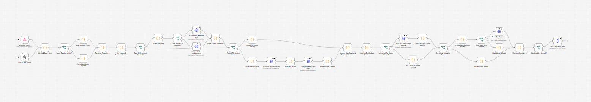

# n8n-hubspot-call-urgency-nlp-routing-engine

> Natural language processing pipeline that analyzes inbound sales call urgency and sentiment, auto-escalating high-priority enterprise prospects to sales leadership.

  -6B4FBB)  

A call platform (or your transcription step) POSTs finished call transcripts to an n8n webhook. For each call the workflow:
1. Authenticates the delivery with a shared secret.
2. Redacts personal data from the transcript.
3. Scores sentiment and urgency with a transparent lexicon engine, optionally blended with an LLM (OpenAI or Anthropic).
4. Classifies the call as **Low / Medium / High / Critical**.
5. Looks up the HubSpot contact and their largest open deal.
6. Writes urgency, sentiment and escalation status back to both records.
7. Routes **High/Critical enterprise** calls to sales leadership in Slack, with **Critical** going to an executive channel, a call summary and HubSpot deep links.

**Safe by default:** imported as-is, a manual run scores synthetic transcripts and makes **zero** external calls. There are **no** AI calls, **no** CRM updates and **no** Slack messages. Webhook deliveries are ignored in sandbox mode, and rejected entirely until a shared secret is configured.

---

## Table of contents

1. [Repository layout](#repository-layout)
2. [Architecture overview](#architecture-overview)
3. [Prerequisites and HubSpot scopes](#prerequisites-and-hubspot-scopes)
4. [5-minute sandbox quick start](#5-minute-sandbox-quick-start)
5. [Step-by-step import and configuration](#step-by-step-import-and-configuration)
6. [Inbound payload contract](#inbound-payload-contract)
7. [Environment variables](#environment-variables)
8. [Required HubSpot properties](#required-hubspot-properties)
9. [NLP scoring logic](#nlp-scoring-logic)
10. [Urgency classification and escalation rules](#urgency-classification-and-escalation-rules)
11. [Prompt engineering guidelines](#prompt-engineering-guidelines)
12. [PII redaction](#pii-redaction)
13. [Slack alert format](#slack-alert-format)
14. [Offline simulator](#offline-simulator)
15. [Safety matrix](#safety-matrix)
16. [Data protection and compliance checklist](#data-protection-and-compliance-checklist)
17. [Troubleshooting](#troubleshooting)
18. [Disclaimer and license](#️-disclaimer--liability-limitation)

---

## Repository layout

```text
n8n-hubspot-call-urgency-nlp-routing-engine/
├── workflow.json                              # Import into n8n (37 nodes, inactive on import)
├── README.md                                  # This file
├── DISCLAIMER.md                              # Liability limitation
├── LICENSE                                    # MIT © 2026 DH Robin (dhRobin Systems)
├── .env.example                               # Placeholder environment template
├── .gitignore
├── sample-payloads/
│   └── call-transcript-fixture.json           # 7 synthetic calls: low → critical, SMB, injection + PII, cooldown
└── scripts/
    └── simulate-sandbox-run.js                # Offline runner for every Code node in workflow.json
```

---

## Architecture overview

```mermaid
flowchart LR
    subgraph Triggers
        W[Webhook Trigger<br/>POST /webhook/call-urgency-intake]
        M[Manual Test Trigger]
    end
    W --> C[Config & Safety Gate<br/>env · secret check · gates]
    M --> C
    C --> R{Route:<br/>Sandbox or Live?}
    R -- sandbox --> F[Load Sandbox Fixture]
    R -- live --> N[Normalize Inbound Payload]
    F --> X[Transcript Redaction & Prep<br/>PII → tokens]
    N --> X
    X --> NLP[NLP Urgency & Sentiment<br/>lexicon engine]
    NLP --> G{AI enrichment<br/>enabled?}
    G -- yes --> B[Build AI Requests]
    B --> P{Provider is<br/>Anthropic?}
    P -- yes --> AA[[AI: Anthropic Messages]]
    P -- no --> AO[[AI: OpenAI Chat]]
    AA --> PB[Parse & Blend AI Analysis]
    AO --> PB
    G -- no --> CR
    PB --> CR{CRM lookup<br/>mode}
    CR -- sandbox --> MC[Mock CRM Lookup]
    CR -- live --> CS[Build Contact Search]
    CS --> HC[[HubSpot: Search Contact]]
    HC --> DS[Build Deal Search]
    DS --> HD[[HubSpot: Search Open Deals]]
    HD --> AC[Assemble CRM Context]
    MC --> D[Urgency Classification &<br/>Escalation Decision]
    AC --> D
    D --> UB[Build HubSpot Update Batches]
    UB --> UG{Live CRM update<br/>allowed?}
    UG -- yes --> HU[[HubSpot: Batch Update Records]]
    HU --> CU[Collect Update Results]
    UG -- no --> DR[Dry-Run CRM Update Preview]
    CU --> ER{Conditional<br/>Escalation Router}
    DR --> ER
    ER -- escalations --> SB[RevOps Slack Block Kit Builder]
    ER -- none --> NE[No Escalation Needed]
    SB --> SG{Slack send<br/>allowed?}
    SG -- yes --> SL[[Slack: Post Escalation Alert<br/>High → sales leadership<br/>Critical → executive]]
    SG -- no --> SS[Slack Alerts Skipped]
    SL --> S[Execution Summary & Audit]
    SS --> S
    NE --> S
    S --> OG{Ops alert<br/>needed?}
    OG -- yes --> OA[[Ops: Post Failure Alert]]

    classDef ext fill:#fff4e6,stroke:#ff7a59;
    classDef gate fill:#eef6ff,stroke:#3b82f6;
    class AA,AO,HC,HD,HU,SL,OA ext;
    class R,G,P,CR,UG,ER,SG,OG gate;
```





Double-bordered nodes are the only ones that make network calls. Each one sits behind a gate that is **closed by default**.

| # | Node | Type | Purpose |
|---|------|------|---------|
| 1 | Webhook Trigger | Webhook | `POST /webhook/call-urgency-intake`, acknowledges immediately |
| 2 | Manual Test Trigger | Manual | Runs the sandbox fixture |
| 3 | Config & Safety Gate | Code | Reads env and applies safe defaults. Checks the shared secret in constant time, then drops headers. Derives every gate. |
| 4 | Route: Sandbox or Live? | IF | Sandbox → fixture; live → the delivered payload |
| 5 | Load Sandbox Fixture | Code | Embedded synthetic calls (mirrors `sample-payloads/`) |
| 6 | Normalize Inbound Payload | Code | Validates the [contract](#inbound-payload-contract). De-duplicates callIds, caps the batch. Fails loudly if nothing is valid. |
| 7 | Transcript Redaction & Prep | Code | Redacts PII, separates prospect from rep speech, caps length |
| 8 | NLP Urgency & Sentiment Analysis | Code | Lexicon sentiment, weighted urgency signals, floors, seat extraction, injection detection |
| 9 | Gate: AI Enrichment Enabled? | IF | `AI_ANALYSIS_ENABLED=true` and `AI_API_KEY` set |
| 10 | Build AI Requests | Code | Provider-specific request with the hardened prompt; redacted text only |
| 11 | Gate: Provider Is Anthropic? | IF | Chooses the provider node |
| 12 | AI: Anthropic Messages API | HTTP | `POST api.anthropic.com/v1/messages` (`x-api-key: {{ $env.AI_API_KEY }}`) |
| 13 | AI: OpenAI Chat Completions | HTTP | `POST api.openai.com/v1/chat/completions` (`Bearer {{ $env.AI_API_KEY }}`) |
| 14 | Parse & Blend AI Analysis | Code | Validates the JSON and blends it with the lexicon. Falls back to the lexicon and applies the injection guard. |
| 15 | Route: CRM Lookup Mode | IF | Sandbox → mock CRM; live → HubSpot |
| 16 | Mock CRM Lookup (Fixture) | Code | Simulated contact and deal |
| 17–21 | Build Contact Search → HubSpot: Search Contact → Build Deal Search → HubSpot: Search Open Deals → Assemble CRM Context | Code/HTTP | **CRM lookup:** contact by `hubspotContactId` or exact email, then deals associated with that contact (open only, largest first) |
| 22 | Urgency Classification & Escalation Decision | Code | Final level, enterprise test, cooldown/duplicate suppression, property updates |
| 23 | Build HubSpot Update Batches | Code | v3 `batch/update` for contacts and deals |
| 24 | Gate: Live CRM Update Allowed? | IF | `allowWrite === true` |
| 25 | HubSpot: Batch Update Records | HTTP | **Property update node** (`/crm/v3/objects/{contacts|deals}/batch/update`) |
| 26 | Collect HubSpot Update Results | Code | Success and failure accounting |
| 27 | Dry-Run CRM Update Preview | Code | The exact updates that *would* run |
| 28 | Conditional Escalation Router | IF | Any call with `escalation.status = escalated`? |
| 29 | RevOps Slack Block Kit Builder | Code | One message per escalation |
| 30 | Gate: Slack Send Allowed? | IF | `allowSend === true` |
| 31 | Slack: Post Escalation Alert | HTTP | High → `$env.SLACK_ALERT_WEBHOOK_URL`; Critical → `$env.SLACK_LEADERSHIP_WEBHOOK_URL` when set |
| 32 | Slack Alerts Skipped | Code | Records the reason |
| 33 | No Escalation Needed | Code | Nothing qualified this run |
| 34 | Execution Summary & Audit | Code | Secret-free, transcript-free audit record + checksum |
| 35 | Gate: Ops Alert Needed? | IF | Errors and the ops gate open |
| 36 | Ops: Post Failure Alert | HTTP | `$env.ALERT_WEBHOOK_URL` |
| — | Safety Notes | Sticky note | On-canvas reminder |

HTTP node behaviour:
- No n8n credentials are stored. Every secret is read from `$env` in node expressions.
- Failed calls retry with a back-off.
- `onError: continueRegularOutput` means one failed call is reported rather than aborting the batch.
- Calls go out one at a time with a delay.

---

## Prerequisites and HubSpot scopes

| Requirement | Notes |
|---|---|
| n8n (self-hosted) | 1.x or newer: Webhook v2, Code v2, IF v2.2, HTTP Request v4.2. n8n Cloud does not allow custom environment variables; on Cloud, replace `$env.X` with `$vars.X` (Variables) or n8n credentials. |
| `$env` access | Set `N8N_BLOCK_ENV_ACCESS_IN_NODE=false`. If access is blocked, the Config node falls back to sandbox + dry-run. |
| Transcripts | This workflow analyses **text**. Transcribe recordings upstream (your dialer, conversation-intelligence tool or an ASR step) and POST the transcript. Recording URLs are ignored. |
| HubSpot | A **developer test account or sandbox** for staging. The custom contact and deal properties [below](#required-hubspot-properties). |
| AI provider (optional) | An OpenAI or Anthropic API key, a model choice, and a data processing agreement covering call content. |
| Slack (optional) | Incoming webhooks for a private sales-leadership channel and, optionally, an executive channel. |
| Node.js ≥ 18 | Only for the offline simulator. No npm dependencies. |

**HubSpot private app scopes:**

| Scope | Used by |
|---|---|
| `crm.objects.contacts.read` | `HubSpot: Search Contact` |
| `crm.objects.contacts.write` | `HubSpot: Batch Update Records` (contact properties) |
| `crm.objects.deals.read` | `HubSpot: Search Open Deals` |
| `crm.objects.deals.write` | `HubSpot: Batch Update Records` (deal properties) |

Creating the custom properties once needs a setup token with property/schema write access, or the HubSpot UI. Contacts and deals are **never created, merged or deleted** by this workflow.

---

## 5-minute sandbox quick start

No accounts, tokens or network needed.

```bash
node scripts/simulate-sandbox-run.js
```

Expected: `All 43 checks passed.` The synthetic fixture covers every routing path:

| Call | Synthetic prospect | Scenario | Expected level → outcome |
|---|---|---|---|
| `mock-call-0001` | Alex Placeholder, SmallBiz Studio | "Nothing urgent", exploring next year (negation test) | **low** → below threshold |
| `mock-call-0002` | Taylor Example, MidMarket Labs | Quote/proposal, decision by quarter end | **medium** → below threshold |
| `mock-call-0003` | Jane Doe, VP Ops, EnterpriseCorp Inc | Budget approved, 2,500 seats, sign by quarter end | **high** → **escalated** (sales leadership) |
| `mock-call-0004` | Morgan Sample, CFO, GlobalHoldings Group | Outage, cancellation threat, competitor, legal | **critical** → **escalated** (executive) |
| `mock-call-0005` | Riley Test, TinyShop Co | "Need it today", 10 seats | **high** → not enterprise, not escalated |
| `mock-call-0006` | Unknown caller | Prompt injection + email, phone, card in transcript; no CRM match | **low** → review flag, PII redacted, AI score ignored |
| `mock-call-0007` | Chris Placeholder, OmegaScale Inc | 900 seats, escalated 2 h ago | **high** → suppressed (cooldown) |

Then:

```bash
n8n import:workflow --input=workflow.json     # or UI: Workflows → Import from File
# Open the workflow, click "Test workflow" (Manual Test Trigger),
# inspect "Urgency Classification & Escalation Decision" and "RevOps Slack Block Kit Builder".
```

---

## Step-by-step import and configuration

1. **Import** `workflow.json`. It arrives **inactive** with no credentials.
2. **Sandbox test:** run the Manual Test Trigger. `Config & Safety Gate` should show `modeLabel: "SANDBOX"` with every `allow*` gate `false`.
3. **Create the HubSpot properties** on contacts and deals in a staging portal ([below](#required-hubspot-properties)).
4. **Create a private app** with the four scopes above. Store `HUBSPOT_ACCESS_TOKEN` on the n8n host (environment or secrets manager, never in the workflow).
5. **Set the webhook secret:** `INBOUND_WEBHOOK_SECRET` (32+ random characters). Configure your call platform to send it in the `x-webhook-secret` header, or set `INBOUND_WEBHOOK_SECRET_HEADER`.
6. **Live dry run:** `SANDBOX_MODE=false`, keep `DRY_RUN=true`, restart n8n and activate the workflow. POST a test payload ([below](#inbound-payload-contract)) to the **production** webhook URL. You'll see `modeLabel: "LIVE-DRY-RUN"`, the read-only HubSpot lookups and a preview of updates. Nothing is written or sent.
7. **Optional AI enrichment:** `AI_ANALYSIS_ENABLED=true`, `AI_PROVIDER=openai|anthropic`, `AI_MODEL=…`, `AI_API_KEY=…`. Compare `lexiconScore` and `aiScore` across a sample of real (consented) calls before trusting the blend.
8. **Tune thresholds** (`URGENCY_*`, `ENTERPRISE_*`) against at least a few dozen reviewed calls.
9. **Enable CRM updates:** `DRY_RUN=false`, `HUBSPOT_MUTATIONS_ENABLED=true`.
10. **Enable Slack:** `SEND_SLACK_ALERTS=true`, `SLACK_ALERT_WEBHOOK_URL`, and optionally `SLACK_LEADERSHIP_WEBHOOK_URL` for Critical. Optionally `SEND_OPS_ALERTS=true` + `ALERT_WEBHOOK_URL`.

> **Promotion rule:** change one flag at a time and re-run the simulator after any workflow, threshold or prompt change.

---

## Inbound payload contract

POST either a single call object, a JSON array, or `{ "calls": [ ... ] }` (up to `MAX_CALLS_PER_DELIVERY`):

```bash
curl -X POST "https://n8n.example.com/webhook/call-urgency-intake" \
  -H "Content-Type: application/json" \
  -H "x-webhook-secret: $INBOUND_WEBHOOK_SECRET" \
  -d '{
    "callId": "mock-call-9001",
    "occurredAt": "2026-11-16T09:00:00Z",
    "direction": "inbound",
    "durationSec": 420,
    "provider": "mock-dialer",
    "hubspotContactId": null,
    "contact": {
      "email": "jane.doe@enterprisecorp.example.com",
      "phone": "+1-555-0102",
      "firstName": "Jane", "lastName": "Doe",
      "title": "VP of Operations",
      "companyName": "EnterpriseCorp Inc",
      "employeeCount": 12000
    },
    "transcript": {
      "segments": [
        { "speaker": "rep", "text": "Where are you in the process?" },
        { "speaker": "prospect", "text": "Budget is approved and we need to sign by the end of the quarter." }
      ]
    }
  }'
```

| Field | Required | Notes |
|---|---|---|
| `callId` | ✅ | `[A-Za-z0-9._:-]`, unique per call. Re-deliveries of a processed callId are skipped. |
| `transcript.segments[]` or `transcript.text` | ✅ | Speakers `prospect/customer/caller/client/buyer/lead` are scored. `rep/agent/ae/sdr/bdr/csm/support` are excluded. Unknown speakers are scored only if no prospect segments exist. |
| `contact.email` or `hubspotContactId` | recommended | Used for the HubSpot match. With neither, the call is scored but nothing is updated. |
| `contact.employeeCount`, `contact.title`, `contact.companyName` | optional | Enterprise test and Slack context |
| `occurredAt`, `direction`, `durationSec`, `provider` | optional | Audit and Slack context |

The workflow throws a visible execution error (after the webhook has already acknowledged) when:
- the secret is missing or wrong;
- `INBOUND_WEBHOOK_SECRET` is unset;
- no valid call is present.

Pair it with an n8n error workflow if you want paging.

---

## Environment variables

| Variable | Default when unset | Description |
|---|---|---|
| `SANDBOX_MODE` | `true` | Synthetic fixture and mock CRM. Webhook payloads are ignored. Forced on if `HUBSPOT_ACCESS_TOKEN` is missing or the run is manual. |
| `DRY_RUN` | `true` | Blocks CRM updates, Slack and ops alerts (reads and optional AI still run) |
| `HUBSPOT_MUTATIONS_ENABLED` | `false` | Opt-in for contact and deal property updates |
| `SEND_SLACK_ALERTS` / `SEND_OPS_ALERTS` | `false` | Opt-in for Slack / ops webhook posts |
| `AI_ANALYSIS_ENABLED` | `false` | Opt-in for LLM enrichment (also needs `AI_API_KEY`) |
| `REDACT_PII` | `true` | Redact transcripts before analysis, AI and Slack (turning off raises a warning) |
| `INBOUND_WEBHOOK_SECRET` | — | Shared secret. **Required** for live deliveries. **Secret.** |
| `INBOUND_WEBHOOK_SECRET_HEADER` | `x-webhook-secret` | Header carrying the secret |
| `MAX_CALLS_PER_DELIVERY` / `MAX_TRANSCRIPT_CHARS` | `50` / `20000` | Intake limits |
| `HUBSPOT_ACCESS_TOKEN` | — | Private app token. **Secret.** |
| `HUBSPOT_PORTAL_ID` | `99000001` | For deep links |
| `HUBSPOT_APP_BASE_URL` | `https://app.hubspot.com` | `https://app-eu1.hubspot.com` for EU portals |
| `UPDATE_DEAL_RECORDS` | `true` | Also update the largest open deal |
| `AI_PROVIDER` | `openai` | `openai` or `anthropic` |
| `AI_MODEL` | `gpt-4o-mini` / `claude-haiku-5-5` | Any model ID your account can use |
| `AI_API_KEY` | — | Provider API key. **Secret.** |
| `AI_BLEND_WEIGHT` | `0.6` | Weight of the AI score in the final score (0–1) |
| `AI_DISAGREEMENT_THRESHOLD` | `35` | Points of AI-vs-lexicon disagreement that trigger a review flag |
| `AI_TIMEOUT_MS` | `20000` | Recorded in config (HTTP node timeout is 60 s) |
| `URGENCY_MEDIUM_THRESHOLD` / `_HIGH_` / `_CRITICAL_` | `40` / `65` / `85` | Score → level cut-offs (must ascend) |
| `SENTIMENT_NEGATIVE_THRESHOLD` / `_POSITIVE_` | `-0.25` / `0.25` | Compound sentiment → label |
| `ENTERPRISE_MIN_EMPLOYEES` | `1000` | Enterprise if employees ≥ this … |
| `ENTERPRISE_MIN_DEAL_AMOUNT` | `50000` | … or largest open deal amount ≥ this … |
| `ENTERPRISE_MIN_SEATS` | `250` | … or seats/users/licences mentioned ≥ this |
| `ESCALATION_MIN_LEVEL` | `high` | Lowest level that can escalate |
| `ESCALATE_CRITICAL_NON_ENTERPRISE` | `true` | Escalate Critical calls even without an enterprise signal |
| `ESCALATION_COOLDOWN_HOURS` | `24` | Suppress repeat escalations of the same contact at an equal/lower level |
| `SLACK_ALERT_WEBHOOK_URL` | — | Sales-leadership channel. **Secret.** |
| `SLACK_LEADERSHIP_WEBHOOK_URL` | — | Executive channel for Critical (falls back to the above). **Secret.** |
| `ALERT_WEBHOOK_URL` | — | Ops JSON webhook. **Secret.** |
| `RUN_TIMESTAMP_OVERRIDE` | — | ISO timestamp to pin the run clock (tests) |
| `N8N_BLOCK_ENV_ACCESS_IN_NODE` | instance default | Must be `false` |

Unrecognised flag values fall back to the **safe** default and are recorded as warnings.

### Sample `.env`

```dotenv
# Safety flags
SANDBOX_MODE=true
DRY_RUN=true
HUBSPOT_MUTATIONS_ENABLED=false
SEND_SLACK_ALERTS=false
SEND_OPS_ALERTS=false
AI_ANALYSIS_ENABLED=false
REDACT_PII=true

# Inbound webhook
INBOUND_WEBHOOK_SECRET=replace-with-long-random-shared-secret

# HubSpot
HUBSPOT_ACCESS_TOKEN=replace-with-hubspot-private-app-token
HUBSPOT_PORTAL_ID=99000001

# AI (optional)
AI_PROVIDER=openai
AI_MODEL=gpt-4o-mini
AI_API_KEY=replace-with-ai-provider-api-key

# Thresholds
URGENCY_MEDIUM_THRESHOLD=40
URGENCY_HIGH_THRESHOLD=65
URGENCY_CRITICAL_THRESHOLD=85
ENTERPRISE_MIN_EMPLOYEES=1000
ENTERPRISE_MIN_DEAL_AMOUNT=50000
ENTERPRISE_MIN_SEATS=250

# Slack / ops
SLACK_ALERT_WEBHOOK_URL=https://hooks.example.com/slack/sales-leadership
SLACK_LEADERSHIP_WEBHOOK_URL=https://hooks.example.com/slack/executive-escalations
ALERT_WEBHOOK_URL=https://alerts.example.com/ops/call-urgency-router

# n8n instance
N8N_BLOCK_ENV_ACCESS_IN_NODE=false
```

See `.env.example` for every variable.

---

## Required HubSpot properties

Create once per portal (UI, or `POST /crm/v3/properties/{objectType}/batch/create` with a setup token). Put them in a `call_intelligence` group, or change `groupName`.

**Contacts (`objectType = contacts`):**

```json
{ "inputs": [
  { "name": "call_urgency_score", "label": "Call Urgency Score", "type": "number", "fieldType": "number", "groupName": "call_intelligence" },
  { "name": "call_urgency_level", "label": "Call Urgency Level", "type": "enumeration", "fieldType": "select", "groupName": "call_intelligence",
    "options": [{"label":"Low","value":"low"},{"label":"Medium","value":"medium"},{"label":"High","value":"high"},{"label":"Critical","value":"critical"}] },
  { "name": "call_sentiment_score", "label": "Call Sentiment Score", "type": "number", "fieldType": "number", "groupName": "call_intelligence" },
  { "name": "call_sentiment_label", "label": "Call Sentiment", "type": "enumeration", "fieldType": "select", "groupName": "call_intelligence",
    "options": [{"label":"Negative","value":"negative"},{"label":"Neutral","value":"neutral"},{"label":"Positive","value":"positive"}] },
  { "name": "call_escalation_status", "label": "Call Escalation Status", "type": "enumeration", "fieldType": "select", "groupName": "call_intelligence",
    "options": [{"label":"Escalated","value":"escalated"},{"label":"Suppressed (cooldown)","value":"suppressed_cooldown"},{"label":"Suppressed (duplicate)","value":"suppressed_duplicate"},{"label":"Not enterprise","value":"not_enterprise"},{"label":"Below threshold","value":"below_threshold"}] },
  { "name": "call_last_analyzed_at", "label": "Call Last Analyzed At", "type": "datetime", "fieldType": "date", "groupName": "call_intelligence" },
  { "name": "call_last_escalated_at", "label": "Call Last Escalated At", "type": "datetime", "fieldType": "date", "groupName": "call_intelligence" },
  { "name": "call_last_call_id", "label": "Call Last Call ID", "type": "string", "fieldType": "text", "groupName": "call_intelligence" },
  { "name": "call_last_summary", "label": "Call Last Summary", "type": "string", "fieldType": "textarea", "groupName": "call_intelligence" },
  { "name": "call_urgency_signals", "label": "Call Urgency Signals", "type": "string", "fieldType": "text", "groupName": "call_intelligence" }
] }
```

**Deals (`objectType = deals`):** `deal_call_urgency_level` (enumeration, same options), `deal_call_urgency_score` (number), `deal_escalation_status` (enumeration, same options as contacts), `deal_last_call_sentiment` (enumeration negative/neutral/positive), `deal_last_call_at` (datetime).

`call_last_call_id`, `call_escalation_status`, `call_last_escalated_at` and `call_urgency_level` are also **read** during lookup. They power re-delivery detection and the escalation cooldown.

---

## NLP scoring logic

All scoring runs on **redacted prospect speech**.

### 1. Sentiment (lexicon, always on)
- Each token is looked up in a weighted lexicon (≈60 terms, −3…+3; e.g. `unacceptable −3`, `frustrated −2.5`, `excited +2.5`, `helpful +1.5`).
- **Negation:** a negator (`not, no, never, don't, isn't, without, hardly…`) within the 3 previous tokens multiplies the weight by −0.75.
- **Intensifiers:** `very ×1.5`, `extremely ×1.8`, `seriously ×1.4`, `frankly ×1.2`, etc.
- **Contrast:** words after `but` / `however` count ×1.5, since the clause after "but" usually carries the real opinion.
- **Compound:** `s / √(s² + 15)`, giving −1…+1. Label: ≤ `SENTIMENT_NEGATIVE_THRESHOLD` negative, ≥ `SENTIMENT_POSITIVE_THRESHOLD` positive, otherwise neutral.

### 2. Urgency signals (lexicon, always on)

| Category (cap) | Example phrases (points) |
|---|---|
| **Timeline** (30) | urgent / urgently 15 · asap, as soon as possible, immediately 14 · today, right away 12 · tomorrow, this week, end of quarter, deadline 10 · end of month, by Friday 8 · go-live 6 |
| **Buying intent** (30) | ready to sign 18 · budget approved\*, sign the contract\* 15 · purchase order\* 12 · procurement, PO 8 · proposal, quote 6 · contract, rollout 5 · pricing, seats 4 |
| **Risk / churn** (30) | cancel, breach 14 · outage, switching to, churn, legal, lawyer 12 · unacceptable, escalate 10 · competitor, refund, downtime 8 · frustrated 6 |
| **Authority** (15) | CEO, CFO 8 · CTO, COO, board, decision maker, c-level 6 · VP, vice president 5 · head of, leadership, executive 4 · director 3 |

How the points combine:
- A repeated phrase earns +50% per extra mention, at most twice.
- A phrase preceded by a negator ("**nothing** urgent", "**no** deadline") scores **0** and is listed under `negatedSignals`.
- `lexiconScore = timeline + intent + risk + authority + negative-sentiment boost (|compound| × 10, max 10)`, clamped to 0–100.

### 3. Hard floors (cannot be overridden by the score or the AI)

| Rule | Minimum level |
|---|---|
| Legal / breach / lawsuit / attorney language | High |
| Risk score ≥ 20 **and** negative sentiment | High |
| Committed buying signals (\* above) ≥ 15 **and** timeline ≥ 10 | High |

### 4. AI enrichment (optional)
- The LLM returns `urgency_score`, `sentiment_score`, `urgency_level`, `summary`, `key_signals`, `recommended_next_step` and `injection_detected`.
- The response is schema-validated: types, ranges and enums are checked, and strings are length-capped.
- **Blend:** `final = AI_BLEND_WEIGHT × ai + (1 − weight) × lexicon`. Sentiment is blended the same way.
- **Fallback:** if the AI times out, errors or returns invalid JSON, the lexicon is used alone and the reason is recorded.
- **Injection guard:** if either the lexicon or the model flags instruction-like text in the transcript, the AI score is **ignored** and the call is flagged for review.
- **Disagreement:** if |AI − lexicon| > `AI_DISAGREEMENT_THRESHOLD`, the blended score is kept but the call is flagged for review.

### 5. Other extraction
- **Seat counts:** the largest number before `seats|users|licences|employees` (e.g. "2,500 seats").
- **Summary:** the AI summary when used; otherwise an extractive summary of the 2 most signal-dense prospect sentences. Sentences that look like prompt injection are dropped.

---

## Urgency classification and escalation rules

```text
score_level = critical if score ≥ 85 · high if ≥ 65 · medium if ≥ 40 · else low   (URGENCY_*_THRESHOLD)
level       = max(score_level, floor_level)

enterprise  = employees ≥ 1000  OR  largest open deal ≥ 50,000  OR  seats mentioned ≥ 250

status =
  already_processed     if contact.call_last_call_id == callId           (re-delivery; no update, no alert)
  below_threshold       if level < ESCALATION_MIN_LEVEL
  not_enterprise        if !enterprise and !(level == critical and ESCALATE_CRITICAL_NON_ENTERPRISE)
  suppressed_cooldown   if contact escalated < ESCALATION_COOLDOWN_HOURS ago at ≥ this level
  suppressed_duplicate  if the same contact escalates twice in one delivery (highest score wins)
  escalated             otherwise

target = executive        if escalated and level == critical and SLACK_LEADERSHIP_WEBHOOK_URL is set
         sales_leadership if escalated otherwise
```

**CRM writes:** every matched, unambiguous contact gets its score, level, sentiment, status, summary and signals. Its largest open deal gets level, score, status and sentiment. Unmatched callers and ambiguous matches (2+ contacts) are never written.

---

## Prompt engineering guidelines

The prompt is in `Build AI Requests`. If you change it:

1. **Keep the transcript fenced.** It sits between `<transcript>` tags, and the system prompt says it is untrusted data. Never interpolate transcript text into the system prompt.
2. **Keep the output contract strict.**
   - JSON only, with exactly the 7 keys.
   - Temperature 0.
   - `response_format: json_object` for OpenAI.
   - Any change to the keys must be mirrored in `Parse & Blend AI Analysis`.
3. **Anchor the scale.** Give explicit score bands per level (the prompt already does), so model scores stay comparable to the lexicon and stable across model versions.
4. **Ask the model to report injection, not obey it.** `injection_detected` is a signal; the workflow, not the model, decides what happens.
5. **Never ask for PII.** The prompt tells the model the tokens (`[EMAIL]`…) are deliberate and must not be reconstructed or echoed.
6. **Keep summaries neutral and short** (≤ 300 chars). They are stored in HubSpot and posted to Slack.
7. **Re-validate after every change.** Run `--mock-ai` and `--ai-garbage` in the simulator. Then compare live dry-run scores against a set of human-labelled calls before trusting the blend again.
8. **Pin model versions** in `AI_MODEL` where your provider supports it, and review the scores when you upgrade.

---

## PII redaction

`Transcript Redaction & Prep` runs before any analysis, AI call or Slack message:

| Pattern | Token |
|---|---|
| Email addresses | `[EMAIL]` |
| 13–19 digit runs that pass Luhn (payment cards) | `[CARD]` |
| Other 13–19 digit runs, SSN-style `123-45-6789`, IBAN-style IDs | `[ID]` |
| Phone numbers (7–15 digits with separators, `+` or parentheses) | `[PHONE]` |

Only redacted text continues past this node. The audit record and Slack never include transcript text, emails or phone numbers.

Redaction is pattern-based. It **will not** catch names, addresses or spoken-out numbers ("four one one one…"). Add patterns for your data, or redact upstream in your transcription tool.

---

## Slack alert format

One message per escalated call (≤ 50 blocks, unfurls off):

- **Header:** 🚨 *Critical call escalation* or 🔥 *High-priority enterprise call*.
- **Prospect:** name, title and company, plus **deep links** to the HubSpot contact (`…/record/0-1/{id}`) and deal (`…/record/0-3/{id}`).
- **Fields:** urgency level and score · sentiment label and score · enterprise signals · open deal amount and stage.
- **Call summary:** marked as AI or extractive, and PII-redacted.
- **Top signals:** category, phrase and points.
- **Suggested next step:** when AI is used.
- **Review warning:** for injection, disagreement or lookup problems.
- **Footer:** call ID, time, duration, scoring method, run ID, and a mode badge (SANDBOX / LIVE DRY RUN).

---

## Offline simulator

`scripts/simulate-sandbox-run.js` executes **`workflow.json` itself**, so what you test is what you import.
- Every Code node runs with n8n-style `$input`, `$env`, `$()` and `$execution`.
- IF nodes are evaluated with strict boolean checks.
- HTTP nodes never open a socket. With mocks enabled, they are answered by an in-memory HubSpot, AI provider and Slack built from the fixture.

```bash
node scripts/simulate-sandbox-run.js                                    # manual sandbox run, zero HTTP
node scripts/simulate-sandbox-run.js --mock-ai                          # + mocked AI enrichment
node scripts/simulate-sandbox-run.js --mock-live                        # authenticated webhook → full live path
node scripts/simulate-sandbox-run.js --mock-live --set AI_PROVIDER=anthropic
node scripts/simulate-sandbox-run.js --mock-live --ai-garbage           # invalid AI output → lexicon fallback
node scripts/simulate-sandbox-run.js --mock-live --fail-writes          # HubSpot 429 → errors + ops alert
node scripts/simulate-sandbox-run.js --mock-live --bad-secret           # webhook rejected, zero HTTP
node scripts/simulate-sandbox-run.js --block-env                        # N8N_BLOCK_ENV_ACCESS_IN_NODE=true
node scripts/simulate-sandbox-run.js --env-file .env                    # your config, secrets masked
```

The host `process.env` is never passed through.

**Checks performed:**
- **Static:** workflow inactive on import, both triggers present, every HTTP node authenticated via `$env` (including `x-api-key`) with no stored credentials, no secret-looking literals, only `example.com` and official API hosts, only `@example.com` addresses, embedded fixture identical to `sample-payloads/`.
- **Behavioural:**
  - the expected level and escalation status for all 7 calls;
  - negation handling;
  - injection guard and injection-free summaries;
  - card, email and phone redaction, with no raw PII anywhere downstream;
  - Slack payloads free of emails and phone numbers;
  - Block Kit limits respected;
  - no secret values in any node output after the trigger;
  - webhook headers never copied into the config item.
- **Mock-live:**
  - webhook secret verified;
  - one contact and one deal search per call;
  - one AI call per call to the selected provider, containing redacted text only;
  - 11 CRM updates;
  - Critical routed to the executive webhook.

The report is written to `sim-output/last-run.json` (git-ignored). The exit code is non-zero on any failed check, so you can use it in CI.

---

## Safety matrix

| `SANDBOX_MODE` | `DRY_RUN` | `HUBSPOT_MUTATIONS_ENABLED` | `AI_ANALYSIS_ENABLED` + key | Data | HubSpot reads | HubSpot writes | AI call | Slack (if enabled + webhook) |
|---|---|---|---|---|---|---|---|---|
| `true` *(default)* | `true` *(default)* | `false` *(default)* | `false` *(default)* | Synthetic fixture | ❌ mock | ❌ preview | ❌ | ❌ |
| `true` | `true` | any | `true` | Synthetic fixture | ❌ mock | ❌ preview | ✅ synthetic text only | ❌ |
| `true` | `false` | any | any | Synthetic fixture | ❌ mock | ❌ preview | per AI flag | ✅ labelled **SANDBOX** |
| `false` (webhook) | `true` | any | any | Live delivery | ✅ | ❌ preview | per AI flag | ❌ |
| `false` (webhook) | `false` | `false` | any | Live delivery | ✅ | ❌ preview | per AI flag | ✅ |
| `false` (webhook) | `false` | `true` | any | Live delivery | ✅ | ✅ contact + deal properties | per AI flag | ✅ |
| `false`, **manual run** or **no token** | any | any | any | Forced fixture | ❌ | ❌ | per AI flag | per Slack gate |
| any, **bad/missing webhook secret** | — | — | — | Rejected | ❌ | ❌ | ❌ | ❌ |
| `$env` blocked | — | — | — | Forced fixture | ❌ | ❌ | ❌ | ❌ |

Ops alerts need `SEND_OPS_ALERTS=true`, `DRY_RUN=false` and `ALERT_WEBHOOK_URL`, and fire only on errors.

---

## Data protection and compliance checklist

- [ ] Call recording and transcription consent is collected as required in every jurisdiction you call into (one-party vs all-party consent), and your privacy notice explains automated call analysis.
- [ ] A data processing agreement covers your AI provider, and its retention and training settings are reviewed. `AI_ANALYSIS_ENABLED` stays `false` until that's done.
- [ ] `REDACT_PII=true`. Redaction has been tested on real (consented) samples of your call content, and extra patterns were added where needed.
- [ ] Staging was done in a HubSpot developer test account or sandbox with `SANDBOX_MODE=true` / `DRY_RUN=true`.
- [ ] The private app has only the four contact/deal scopes. Tokens, API keys, webhook URLs and the inbound secret live only in the n8n host environment or secrets manager. `.env` is git-ignored.
- [ ] `INBOUND_WEBHOOK_SECRET` is long, random and rotated regularly. n8n execution data, which stores request headers and transcripts, is restricted and has a retention period that matches your policy.
- [ ] Slack escalation channels are private, limited to sales leadership, and contain no emails, phone numbers or raw transcripts.
- [ ] Scores and summaries on contact records are covered by your data-subject access and deletion process.
- [ ] Thresholds were validated against human-reviewed calls. A named owner reviews `needs review` calls and false escalations weekly.
- [ ] Urgency and sentiment scores are used for prioritisation only, never for decisions about individuals' eligibility, pricing or employment.
- [ ] `node scripts/simulate-sandbox-run.js` passes after every workflow, threshold or prompt change.

---

## Troubleshooting

| Symptom | Cause / fix |
|---|---|
| Execution error "Inbound webhook rejected (rejected_no_secret_configured)" | Set `INBOUND_WEBHOOK_SECRET` and restart n8n |
| "…rejected_bad_secret" | The sender's header value or name differs. Check `INBOUND_WEBHOOK_SECRET_HEADER`. |
| Webhook delivery processed the fixture instead | `SANDBOX_MODE` is still `true` (see `warnings`) |
| `modeLabel` stays `SANDBOX` with `SANDBOX_MODE=false` | Manual runs always use the fixture, or `HUBSPOT_ACCESS_TOKEN` is missing |
| Every call shows `lexicon_only_ai_failed` | Wrong `AI_API_KEY`, `AI_MODEL` or provider; check the AI node output |
| `lexicon_only_ai_invalid` | The model returned non-JSON. Keep temperature 0, keep the output contract, and try a stronger model. |
| Contacts never match | The payload email differs from the HubSpot email, or send `hubspotContactId` |
| HubSpot `400` on batch update | A custom property is missing or an enumeration value is undefined ([above](#required-hubspot-properties)) |
| Same prospect alerted repeatedly | Raise `ESCALATION_COOLDOWN_HOURS`, and check that the contact updates succeed (the cooldown reads `call_last_escalated_at`) |
| Too many/too few escalations | Tune `URGENCY_*` and `ENTERPRISE_*`, review `topSignals` and `floors` in the decision output |

---

## ⚠️ Disclaimer & Liability Limitation

**Use at your own risk.** The code, workflows, and scripts in this repository (**n8n-hubspot-call-urgency-nlp-routing-engine**) are provided for educational and architectural demonstration purposes.

**No Liability:** The author and dhRobin Systems accept no responsibility or liability for any direct, indirect, incidental, or consequential damages that result from using, misusing, or deploying these scripts.

**No Warranty:** All software, n8n JSON blueprints, JavaScript modules and prompts are provided "AS IS", without warranty of any kind, express or implied. This includes, but is not limited to, warranties of merchantability, fitness for a particular purpose, and non-infringement.

**Production Testing Required:** Always test thoroughly in an isolated staging environment, such as a HubSpot developer test account or sandbox, with `SANDBOX_MODE=true` and `DRY_RUN=true` enabled, before you connect live HubSpot, AI provider or Slack credentials. Treat every urgency score, sentiment label, summary and escalation as decision support that a person must review before it's acted on.

**Third-Party APIs & Compliance:** You alone are responsible for complying with the terms of service, rate limits, data privacy regulations (GDPR/CCPA), and security policies of HubSpot, OpenAI, Anthropic, Slack and any connected services. That includes:
- obtaining call-recording and transcription consent;
- confirming a lawful basis and data processing agreement before sending call transcripts to an AI provider;
- keeping personal data out of prompts, Slack alerts and CRM summaries;
- reviewing every automatically updated record and every escalation.

The full disclaimer is also available in [DISCLAIMER.md](DISCLAIMER.md).

## License

Released under the MIT License. Copyright (c) 2026 DH Robin (dhRobin Systems). See [LICENSE](LICENSE).

---

Full text: DISCLAIMER.md · Licensed under the MIT License. License: MIT © 2026 DH Robin (dhRobin Systems) · Provided as-is, see the disclaimer.
